

<picture>
  <source media="(prefers-color-scheme: dark)" srcset="public/assets/elo-logo-white.svg">
  
</picture>

### Cada chamado no lugar certo, do registro à resolução.

Gestão de chamados de TI da [ETEC Bento Quirino](https://etecbentoquirino.com.br/new/).

 

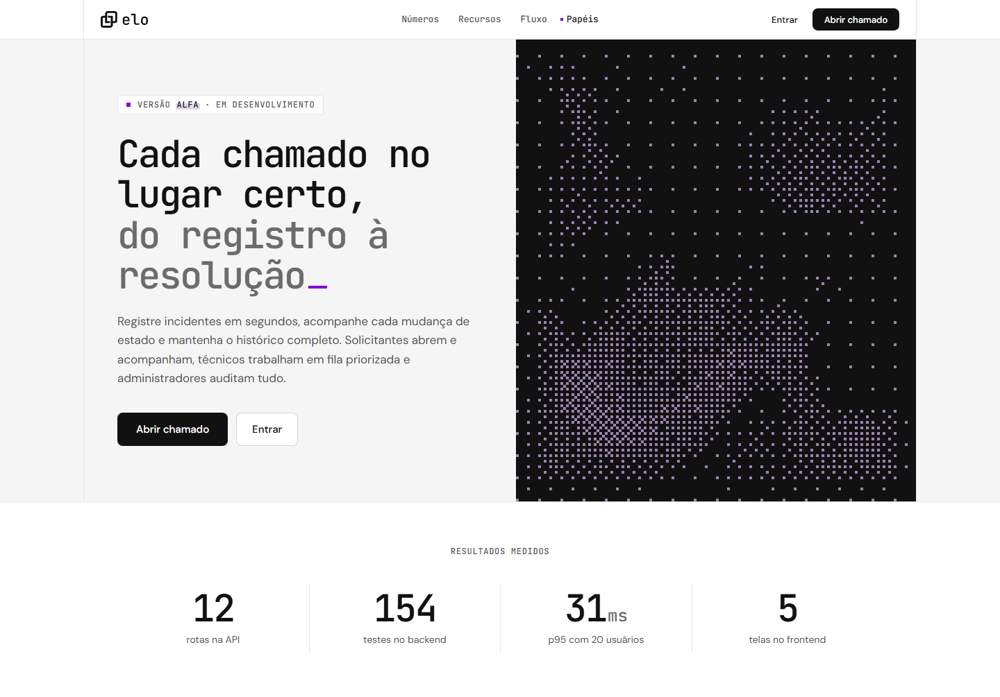

---

## O que é

O **Elo** organiza os pedidos de suporte de TI da escola. Quem tem um problema abre um
chamado em segundos; a equipe técnica trabalha numa fila priorizada; a administração
acompanha os totais e audita cada mudança. Todo chamado percorre um fluxo claro —
**Aberto → Em análise → Em atendimento → Resolvido → Fechado** — e cada passo fica
registrado com quem fez, quando e o que mudou.

> **Versão alfa (0.1).** A interface está pronta para uso e testes; o sistema ainda está
> em desenvolvimento e várias melhorias estão por vir.

## Para cada papel

| | Solicitante | Técnico | Administrador |
| :-- | :-- | :-- | :-- |
| **Faz** | abre chamados e acompanha cada mudança | atende a fila, muda estado e prioridade, assume chamados | tudo do técnico + exclusão com justificativa |
| **Vê no início** | atalho para abrir chamado e os seus em andamento | o que precisa de atenção, o fluxo e a fila mais urgente | o mesmo, com a visão de todos os chamados |

## O app

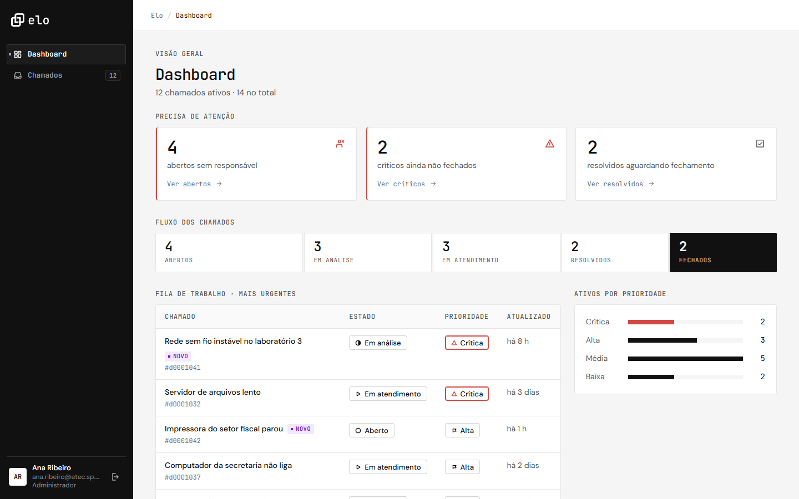

<b>Dashboard</b> — o que precisa de atenção agora, como os chamados avançam e os mais urgentes.

<table>
  <tr>
    <td width="50%">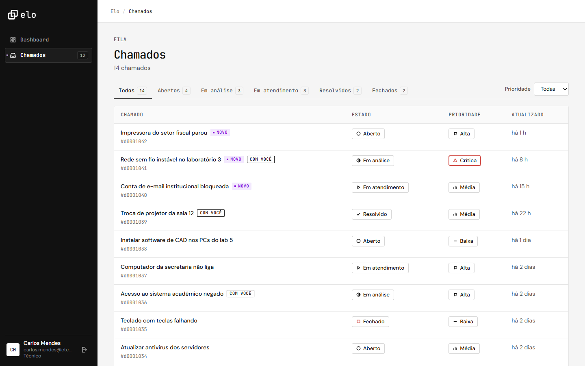</td>
    <td width="50%">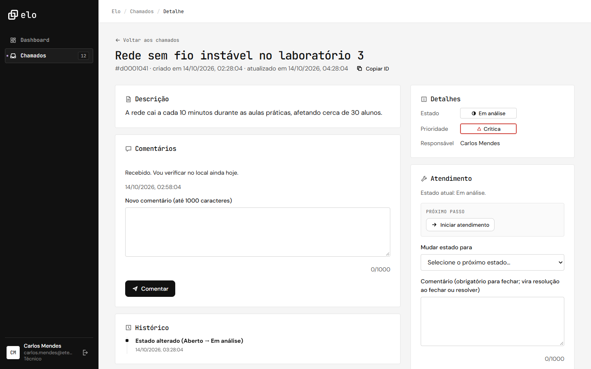</td>
  </tr>
  <tr>
    <td align="center"><b>Chamados</b> — abas por estado, selos "novo" e "com você", linha inteira clicável.</td>
    <td align="center"><b>Detalhe</b> — conversa e histórico à esquerda; ações e "próximo passo" à direita.</td>
  </tr>
  <tr>
    <td width="50%">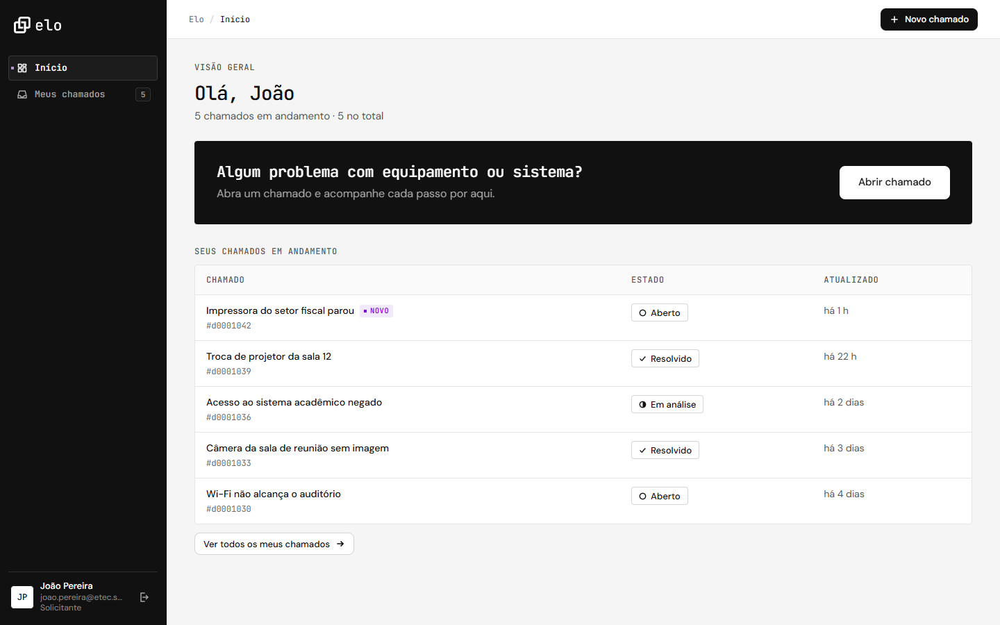</td>
    <td width="50%">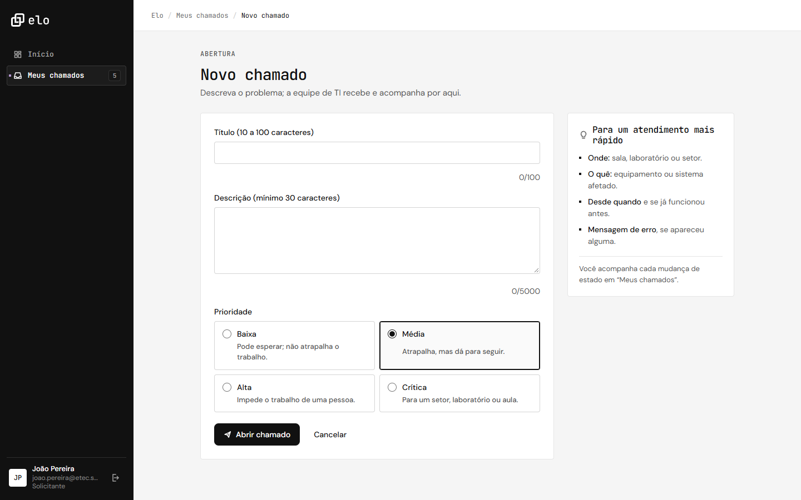</td>
  </tr>
  <tr>
    <td align="center"><b>Início do solicitante</b> — abrir chamado é a ação principal.</td>
    <td align="center"><b>Novo chamado</b> — prioridade explicada e dicas para um atendimento rápido.</td>
  </tr>
</table>

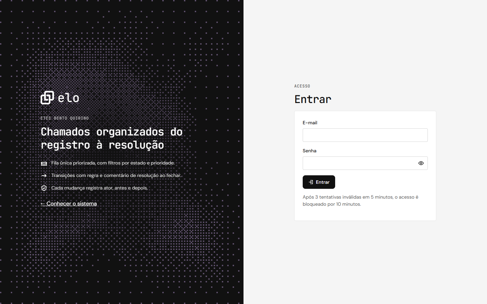

<b>Entrar</b> — sessão segura em cookie, com aviso de bloqueio após tentativas inválidas.

## No celular

<table>
  <tr>
    <td align="center" width="50%">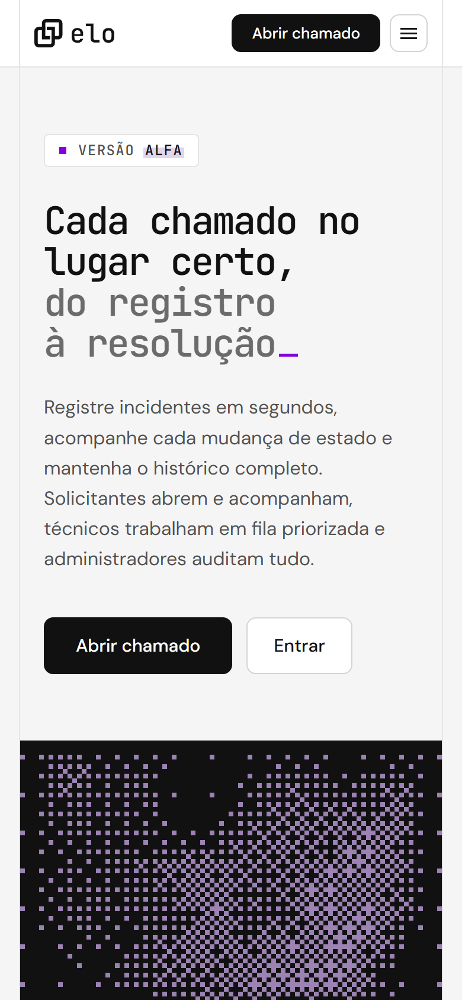</td>
    <td align="center" width="50%">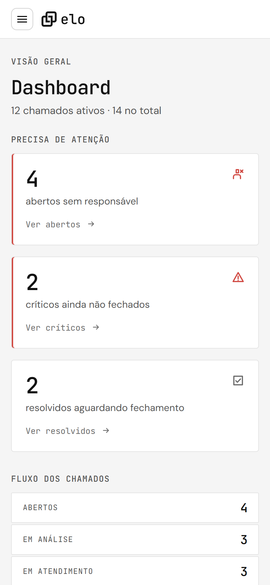</td>
  </tr>
  <tr>
    <td align="center">Página inicial</td>
    <td align="center">Dashboard — a barra lateral vira menu</td>
  </tr>
</table>

## O site

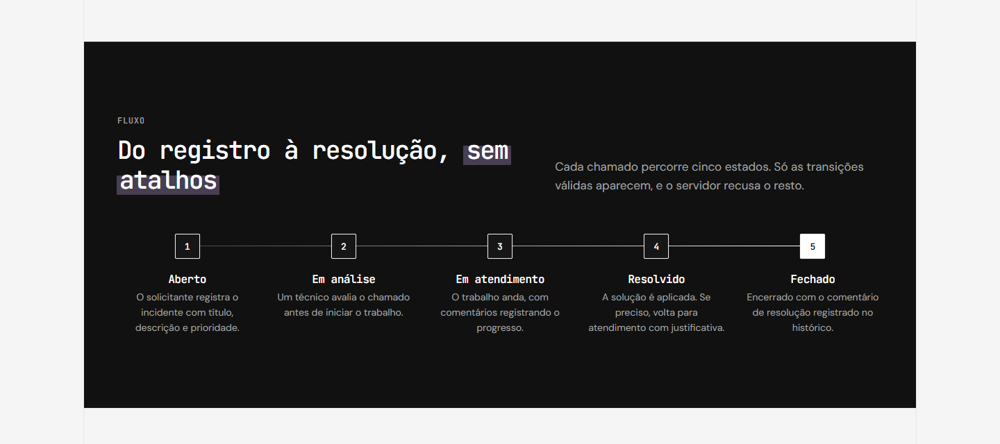

<b>Ver a página inicial completa</b>

 

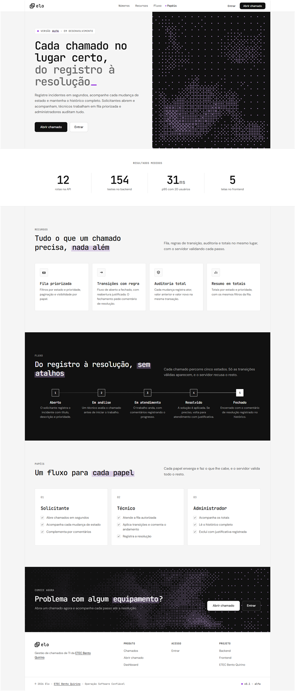

## Experiência

- **Feedback em tudo:** esqueletos enquanto carrega, barra de progresso, spinner nos botões
  (inclusive no login) e confirmações em toast.
- **Fluxo guiado:** atalhos de "próximo passo" no detalhe, cards do dashboard que levam à
  lista já filtrada, prioridade explicada ao abrir chamado.
- **Acessível:** navegação por teclado, foco visível, estado sempre em texto + símbolo,
  leitor de tela anunciando cada ação e respeito a "reduzir movimento".
- **Responsivo:** do celular (375px) a monitores largos.

## Design

Preto e branco, com o roxo do ícone aparecendo só em momentos pontuais. Títulos em
**JetBrains Mono**, texto em **DM Sans**, cantos retos em linguagem de pixel e um fundo
pixelado em WebGL feito do zero. Seções claras e escuras se alternam a partir dos mesmos
tokens.

Regras completas em [`docs/design-system.md`](docs/design-system.md).

## Tecnologia

HTML, CSS e JavaScript nativos (ES modules), sem framework, sem build e sem dependências de
runtime. Testes com Jest, lint com ESLint e CI no GitHub Actions. O site é estático e vai
para a **Vercel** em breve.

Estrutura, rotas da API, segurança, modo demonstração, testes e deploy:
**[documentação técnica →](docs/README.md)**

## Projeto

- [Backend](https://github.com/HelpDesk-BQ/Backend) — API e banco de dados
- [ETEC Bento Quirino](https://etecbentoquirino.com.br/new/) · Operação Software Confiável

 

  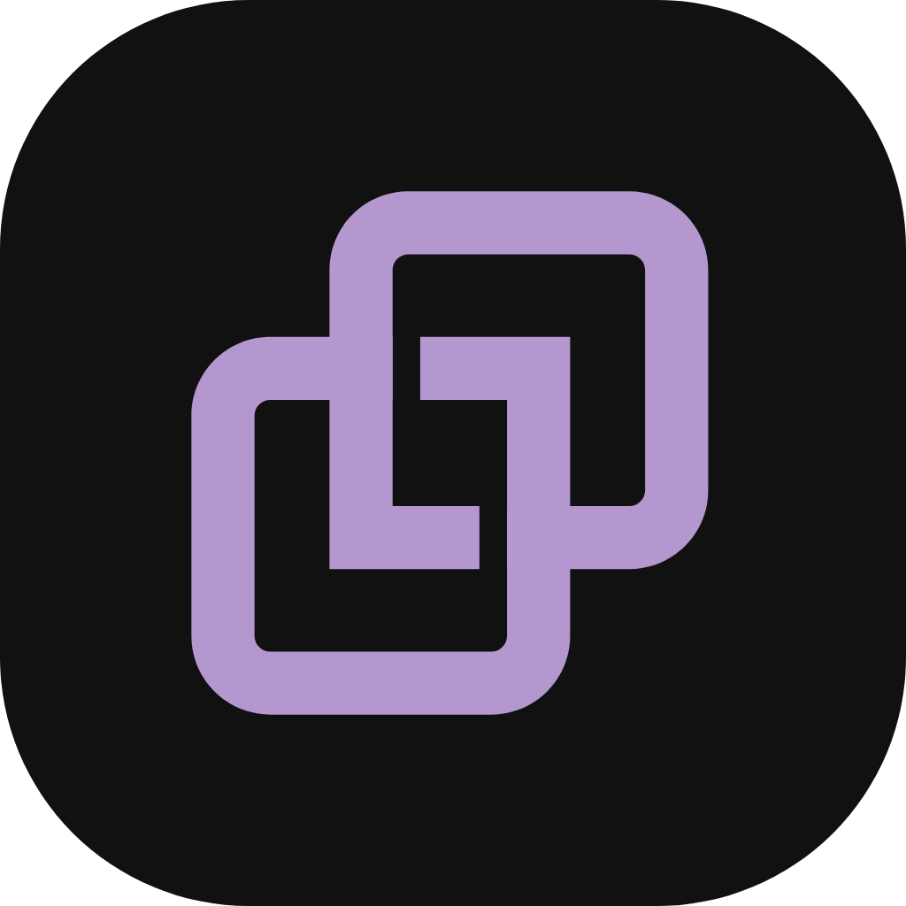
   
  Elo · v0.1 alfa

